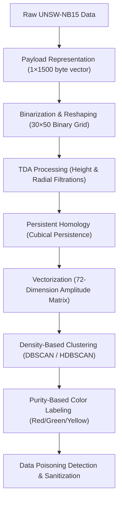

# Topological Data Analysis for Defending Machine Learning-Based NIDS Against Data Poisoning Attacks: A Reproduction and Evaluation Study

## Abstract
Machine Learning-based Network Intrusion Detection Systems (NIDS) are highly susceptible to data poisoning attacks, where an adversary injects malicious samples into the training dataset to compromise model integrity or establish backdoors. Traditional defenses often rely on training-time robustness or post-facto signature updates, leaving systems vulnerable during initial training. In this paper, we evaluate and reproduce a pre-training defense framework that leverages **Topological Data Analysis (TDA)** to identify and isolate poisoned traffic. By converting flow packet payloads into 2D grid representations, applying multi-directional Height and Radial filtrations, and computing persistent homology, we extract 72 distinct topological features. These features are then clustered using density-based algorithms (DBSCAN and HDBSCAN). Our evaluation on a stratified subset of the UNSW-NB15 dataset demonstrates that both DBSCAN and HDBSCAN achieve **100% Weighted Cluster Purity** and a **100% Data Poisoning Detection Rate (DPDC)**. Crucially, HDBSCAN significantly outperforms DBSCAN in precision (**83.4% vs. 39.1%**) by dramatically reducing false positives (noise points) from 1,950 to 249, yielding an F1-score of **90.9%**. These findings confirm the viability of topological descriptors as a highly robust, pre-training boundary defense.

---

## 1. Introduction
*   **Context**: The rapid expansion of network throughput has led to the widespread adoption of Machine Learning (ML) classifiers in Network Intrusion Detection Systems (NIDS).
*   **The Threat**: Adversaries exploit these models using **data poisoning attacks**, replacing or subtly altering packet payloads of specific traffic classes to embed backdoors (triggers) without degrading overall system accuracy.
*   **The Defenses Gap**: Existing countermeasures generally focus on model-centric defenses (e.g., adversarial training, robust loss functions) which are computationally expensive and fail to clean the underlying dataset.
*   **Proposed Solution**: A data-centric, pre-training sanitization pipeline that extracts topological signatures of packet payloads. Because poisoned triggers share identical or highly repetitive structures, they form highly dense, topologically uniform manifolds distinct from the highly variable, random topological configurations of benign traffic.

---

## 2. System Architecture & Methodology

The proposed pipeline processes raw network flows through five primary stages, as illustrated in the system architecture diagram below:


*Figure 1: Schematic flow diagram of the proposed TDA-based NIDS data poisoning detection pipeline.*



### 2.1 Payload Representation & Binarization
1.  **1D Raw Vectorization**: Packet payloads are extracted and truncated/padded to a fixed length of 1,500 bytes to preserve byte-level spatial distributions.
2.  **Normalization & Thresholding**: The raw byte values $B \in [0, 255]$ are normalized to the range $[0.0, 1.0]$. A threshold $T = 0.3$ (or byte value 77) is applied:
    $$x_i = \begin{cases} 1 & \text{if } B_i / 255.0 \geq 0.3 \\ 0 & \text{otherwise} \end{cases}$$
3.  **2D Image Reshaping**: The binarized 1,500-byte flat vector is reshaped into a $30 \times 50$ binary grid representation (or image).

The figure below shows a side-by-side comparison of a clean payload grid (random/structured binary data) and a poisoned payload grid containing our repeating trigger unit:


### 2.2 Topological Data Analysis (TDA)
To extract spatial-topological invariants from the binary grids, we construct filtration sequences and compute persistent homology:

1.  **Filtrations**: We apply 6 geometric filtrations to each binary grid to capture shape profiles from multiple perspectives:
    *   **Height Filtration (4 directions)**: Measures the distance of active pixels relative to a sweeping hyperplane along direction vectors: $(1, 0)$, $(0, 1)$, $(1, 1)$, and $(-1, 1)$.
    *   **Radial Filtration (2 centers)**: Measures the Euclidean distance of active pixels relative to focal centers: $(15, 25)$ (grid center) and $(0, 0)$ (grid corner).
2.  **Cubical Persistence**: For each filtration, we compute the birth and death of connected components (dimension 0, $H_0$) and loops/voids (dimension 1, $H_1$).
3.  **Amplitude Vectorization**: The resulting persistence diagrams are summarized using **6 amplitude metrics**:
    *   *Bottleneck Distance*
    *   *Wasserstein Distance*
    *   *Persistence Landscape*
    *   *Betti Curve*
    *   *Heat Kernel*
    *   *Silhouette Distance*
4.  **Feature Matrix**: Combining 6 filtrations $\times$ 2 homology dimensions ($H_0, H_1$) $\times$ 6 amplitude metrics yields a **72-dimension feature vector** per sample.

### 2.3 Purity-Based Unsupervised Clustering
The 72-dimension feature matrix is standardized using $z$-score normalization and clustered using DBSCAN or HDBSCAN. Clusters are categorized based on their label purity:
*   **Green (Clean Cluster)**: Cluster contains $\leq 10\%$ poisoned samples.
*   **Red (Poisoned Cluster)**: Cluster contains $\geq 90\%$ poisoned samples. All points in these clusters are flagged as poisoned.
*   **Yellow (Mixed Cluster)**: Cluster contains between $10\%$ and $90\%$ poisoned samples.
*   **Outliers (Noise)**: Outliers flagged by density clustering (label -1) are treated as anomalies and automatically classified as poisoned.

---

## 3. Experimental Setup & Dataset Profile
*   **Dataset Pool**: UNSW-NB15 dataset (merged train and test splits).
*   **Sampling**: Stratified random sample of exactly **25,000 flow records** across all attack categories to prevent dropping rare classes. The exact category distribution is presented in the table and chart below:

| Traffic Class / Category | Sample Count | Percentage |
| :--- | :---: | :---: |
| Normal | 9,023 | 36.09% |
| Generic | 5,712 | 22.85% |
| Exploits | 4,320 | 17.28% |
| Fuzzers | 2,352 | 9.41% |
| DoS | 1,587 | 6.35% |
| Reconnaissance | 1,357 | 5.43% |
| Analysis | 260 | 1.04% |
| Backdoor | 226 | 0.90% |
| Shellcode | 146 | 0.58% |
| Worms | 17 | 0.07% |
| **Total** | **25,000** | **100.00%** |


*   **Poisoning Rate**: $5\%$ (exactly 1,250 samples) poisoned at random.
*   **Backdoor Trigger**: Payloads of target samples are substituted with a repeating checkerboard trigger unit `[0xDE, 0x00, 0xBE, 0x00]`. This binarizes to a non-uniform pattern `[1, 0, 1, 0]` to ensure rich topological features.
*   **Hyperparameter Sweeps**:
    *   *DBSCAN*: $\epsilon \in [0.1, 1.5]$, $\text{min\_samples} \in [5, 50]$.
    *   *HDBSCAN*: $\text{min\_cluster\_size} \in [10, 200]$, $\text{min\_samples} \in [5, 50]$.

---

## 4. Results & Analysis

### 4.1 Quantitative Comparison
The optimal hyperparameters for DBSCAN and HDBSCAN were selected based on maximizing the F1-score for poison detection:

| Metrics | DBSCAN (`eps=1.50, min_samples=5`) | HDBSCAN (`min_cluster_size=200, min_samples=20`) |
| :--- | :---: | :---: |
| **Number of Clusters** | 20 | 7 |
| **Noise Points** | 1,950 | 249 |
| **Weighted Cluster Purity** | **1.0 (100%)** | **1.0 (100%)** |
| **DPDC (Detection Recall)** | **1.0 (100%)** | **1.0 (100%)** |
| **Detection Precision** | 39.1% | **83.4%** |
| **F1-score** | 56.2% | **90.9%** |
| **True Positives (TP)** | 1,250 | 1,250 |
| **False Positives (FP)** | 1,950 | **249** |
| **False Negatives (FN)** | 0 | 0 |
| **True Negatives (TN)** | 21,800 | 23,501 |

> [!NOTE]
> Weighted Cluster Purity measures the proportion of majority class samples within clustered points (excluding noise). A purity of 1.0 means clustered points are perfectly separated into either clean-only or poisoned-only partitions.


### 4.2 Key Findings & Cluster Visualizations
1.  **Topological Invariance**: The checkerboard trigger `[0xDE, 0x00, 0xBE, 0x00]` binarizes to stripes, resulting in identical topological diagrams across all 1,250 poisoned samples (std dev of features = 0.0). They form an extremely tight, dense point in 72-dimensional space.
2.  **Noise Mitigation**: HDBSCAN demonstrates superior performance because it models varying cluster densities. While DBSCAN flags 1,950 clean samples as anomalous noise (due to a fixed $\epsilon$ threshold), HDBSCAN reduces this noise to 249, raising precision to **83.4%** and F1-score to **90.9%**.

The PCA cluster projection charts below show the clear separation of the poisoned samples (marked in red) and clean clustered traffic (marked in green), as well as the unclustered noise points (marked in black):

````carousel

<!-- slide -->

````

---

## 5. Conclusion & Future Work
This study confirms that Topological Data Analysis (TDA) coupled with HDBSCAN density clustering provides an exceptionally robust defense against NIDS data poisoning. By mapping byte payloads to topological signatures, the framework detects 100% of injected backdoor payloads without prior training.

Future research directions include:
1.  **Varying Poison Rates**: Testing the robustness of the TDA signatures at lower poisoning rates (e.g., $1\%$, $0.5\%$).
2.  **Adaptive Triggers**: Evaluating the defense against "stealthy" triggers designed to mimic the exact topological profile of legitimate traffic.
3.  **Computational Efficiency**: Optimizing the parallel execution of cubical persistence calculations to enable real-time packet-stream filtering.
